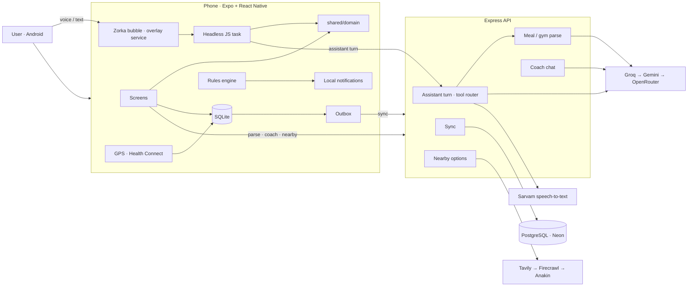

<p align="center">
  
</p>

<p align="center">
  Your calories, workouts and cardio in one app, and it tells you what to do next.
</p>

As a fitness geek myself, I often had to use three different apps to track my calorie intake, my workouts and my
cardio. So why not have one master app where I can do all of this with the least friction? That's where Zorka comes
into play :)

The goal is to bring in both fitness geeks and everyday people, and let them enjoy that side of the world where
discipline shapes their whole life into something better.

<p align="center">
  
  
  
  
  <br />
  
  
  
  
  
  <br />
  
  
  
  
  
</p>

---

## What it is

**Talk to Zorka from anywhere**
- A small tiger bubble sits on the edge of the screen, over every app (Android)
- Tap it and say what you did: "had poha and chai for breakfast, 2 glasses of water"
- Ask about your day: "what's left for dinner?", "what's my bench PR?", "would dal rice fit my gap?"
- Fix things by voice: "actually breakfast was upma", "make it 2 katori", "delete last night's dinner"
- Plan ahead: "out of city tomorrow, only 75 g protein", "remind me at 6 to stretch"
- English, Hindi and Hinglish all work

**Log**
- Log meals by voice, photo or text, and always review them before saving
- Repeat a past meal in one tap
- Log gym sets by voice, with last session's numbers, a rest timer and PR detection
- Record runs, walks and rides with GPS, offline and with the screen off

**Close the gap**
- See the calories and protein left today, paced to the time of day
- Get 3–5 ranked ways to close the gap: your usual meals, home foods or nearby options
- A coach persona who nudges you during the day; the Zorka tab keeps your whole thread with it

**See your progress**
- 90-second onboarding with a real goal and target date
- A smoothed weight trend that ignores water swings
- A weekly check-in that adjusts your targets from what actually happened
- Phases with a frozen summary when they end
- A streak with freezes, celebrations and share cards

## How it works

- **Local-first.** Every log is saved on the phone first and synced to the server later, so nothing waits on the network.
- **One shared brain.** Targets, the gap, the trend, the streak and the nudge rules live in one pure TypeScript
  layer, used by both the phone and the server.
- **AI drafts, you decide.** Voice, photos and text become food items through an AI chain with fallbacks. You
  always confirm before anything is saved.
- **Safe by design.** Calorie floors, capped weekly changes, no late-night workouts and no shaming copy.

## The Zorka bubble

The bubble is a native Android overlay (`mobile/modules/zorka-overlay`). Tap the tiger to talk (tap again, or 2 s of
quiet, to send), hold it to type, drag it to any edge. The tiger shows what's happening: it grows with your voice,
pulses while Zorka works, bounces when something was done, leans when it needs you and shakes when it can't help. A
card under it shows the answer or asks you to approve, and stays up long enough to read.

**How a turn works** (`POST /v1/users/:id/assistant/turn`, one round trip):

1. **Speech to text.** Sarvam first (good with Hindi and Hinglish), then the usual Groq → Gemini → OpenRouter chain.
   Hindi in Devanagari is romanized, and words Zorka has mis-heard before are rewritten with your learned aliases.
2. **Router.** An LLM with tools (`backend/src/modules/assistant/agent.ts`) turns the words into actions: `log_meal`,
   `log_water`, `log_workout`, `log_weight`, `start_activity`, `set_day`, `set_target`, `plan_meal`, `remind_me`,
   `edit_meal`, `set_amount`, `delete_entry`, `create_routine`, `answer_question` and a few more. It sees what's
   logged today and yesterday, so "actually breakfast was X" edits the right meal. Each call is checked as it's made
   and a rejected call goes back to the model to fix (up to 5 steps). If a model is rate limited the next one is
   tried, and if the tool router fails the older one-shot JSON router takes over (`ASSISTANT_ROUTER=tools|json`).
3. **Checks.** Every action must pass a strict schema, quote words that were actually said, and stay inside the shared
   bounds in `shared/domain/assistant.ts` (dates from yesterday to a week ahead, at most 5 actions and 1 edit a turn,
   numbers only when you said them).
4. **Resolve.** Foods go through the meal parser, sets through the gym parser, day types through the planner.
   Questions are answered from facts the code computes, never from the model. "Would X fit my gap?" weighs the
   parsed food against what's left today, and advice questions get a short coach answer over today's facts.
5. **Reply.** The persona phrases a reply over the results only, and a filter checks that every number in it is real.

**Nothing is saved on the server.** The phone checks every action again and runs it with its own stores, keeping the
stricter of the two verdicts. Each action lands in one of these:

| Tier | What happens | Examples |
|---|---|---|
| Do | Saved straight away, with undo | A meal heard clearly for today, 2 glasses of water, start a walk |
| Approve | Shown on the card first | Edits, deletes, new amounts, a day's target, a routine, anything not on today, a weight 2 kg off the last one |
| Ask | Zorka asks a short question with options | When what you said could mean two things |
| Answer | Shown, nothing saved | Questions, exercise how-tos |
| Refuse | Politely declined | Anything not about your own health, or asks to break the rules |

The router is graded against a set of English, Hinglish, mis-heard, multi-action and adversarial phrases
(`backend/test/fixtures/assistant/`). `npm run eval:assistant` runs it against the real models.

## Architecture



```
backend/   Express + Prisma API
mobile/    Expo app
shared/    Pure domain logic used by both
```

The full diagram is in `docs-arch/architecture.excalidraw` (open it at [excalidraw.com](https://excalidraw.com)).

## Trade-offs

| Chose | Over | Because |
|---|---|---|
| Local-first + sync | Server-only CRUD | Logging has to work in a basement gym |
| Last-write-wins sync | Merge-level conflict resolution | One user on one phone, so conflicts are rare |
| Streak and targets derived from logs | Stored values | Nothing to drift out of sync |
| Local notifications | Push from a server | No Firebase, and it works offline |
| Free-tier AI with fallbacks | One paid model | Zero cost; the confirm step absorbs model variance |
| Search snippets for nearby food | Live menus | No scraping; every number is marked as an estimate |
| A system overlay bubble | An in-app voice button | Logging happens while you're in WhatsApp or Swiggy, not inside Zorka |
| LLM picks actions, code computes numbers | LLM answers directly | The model never makes up calories, targets or PRs |
| Every action checked twice, saved only on the phone | Server writes the result | A wrong or tampered answer still can't write outside the bounds |
| Approve edits and deletes, do clear logs | Confirm everything | Fast for the common case, careful for anything you can't easily see |
| In-memory rate-limit counters | Redis | One Render instance, so no new infra yet; the store can be swapped for Redis later |

## Performance

Load-tested with [k6](https://k6.io) (October 2026). Each virtual user replays an app session: open the app, browse
foods, workouts and routines, and push a sync batch one time in three. AI and search endpoints are left out because
they call paid providers.

| Setup | Throughput | p50 / p95 / p99 | Errors |
|---|---|---|---|
| API + Postgres on one PC, 50 users | 80 req/s | 32 / 178 / 354 ms | 0% |
| Same, stress up to 800 users | 110–120 req/s ceiling | 2.4 s / 8.4 s / 18.6 s | 0% |
| Hosted on Render free, 10 users | not at a limit | 881 ms / 1.9 s / 2.5 s | 0% |

- **Comfortable limit:** about 50 very active users at once (each opening the app every ~3 s) before p95 passes 300 ms.
- **It slows down, it doesn't fall over:** no failed requests even at 800 concurrent users.
- **The bottleneck is one CPU core,** mostly spent turning large `/changes` sync responses into JSON.
- **Database distance matters most.** With the API on a PC far from the Neon database in Ohio, every query cost a
  230 ms round trip and the old 10-connection pool capped the API at ~9 req/s. The pool size is now configurable
  (`DB_POOL_MAX`, default 20).
- **Still to measure:** a Render-sized box (0.1 CPU, 512 MB) with `npm run loadtest:constrained`, and a 2-hour soak.

## Rate limits

Every API route is rate limited, with tighter limits on the routes that call AI models and the search API. User ids
aren't authenticated yet, so each request also counts against a per-IP ceiling: switching ids doesn't get around it.

| Routes | Limit | Env vars |
|---|---|---|
| Every route, per user id | 120 / min | `RATE_LIMIT_PER_MIN_USER` |
| Every route, per IP | 300 / min | `RATE_LIMIT_PER_MIN_IP` |
| AI: meal parse (text, voice, photo), gym voice parse, coach chat, brief, week plan, assistant turn | 5 / min, 40 / day per user on Render (10 / min, 100 / day by default) | `RATE_LIMIT_AI_PER_MIN`, `RATE_LIMIT_AI_PER_DAY` |
| AI + search: food lookup, nearby | 5 / min, 30 / day per user | `RATE_LIMIT_SEARCH_PER_MIN`, `RATE_LIMIT_SEARCH_PER_DAY` |
| Menu scan (vision), per page | 12 / min, 72 / day per user | fixed in code |

- **Over the limit:** `429` with the usual error shape (`code: "RATE_LIMITED"`, `details.retryAfterSeconds`) and a
  `Retry-After` header. The app shows the message, and sync retries with backoff.
- **Never limited:** `/v1/health` and `/`, so Render's health check and the app's warm-up ping always get through.
- **Daily caps reset at 00:00 UTC.** Requests turned away by the per-minute limit don't use up the daily quota.
- **Counters live in memory,** so they reset when the free instance sleeps or redeploys. Moving them to Redis would
  make daily caps survive restarts and work across several instances.
- **Behind Render's proxy,** `TRUST_PROXY=1` makes the client IP the phone's, not the load balancer's. Check that
  `clientIp` in the request logs differs between devices.
- `RATE_LIMIT_ENABLED=false` turns it all off (used for load tests). The code is in `backend/src/http/rateLimit.ts`.

## Future plans

- Real accounts and auth
- Redis-backed rate limits
- Community features: follows, kudos and leagues
- iOS support with HealthKit (the bubble is Android-only; iOS has no overlays)
- Nudges that adapt to the ones you ignore
- Calorie credit for gym sessions

## Run it locally

```bash
# API
cd backend && npm install
cp .env.example .env    # fill in DATABASE_URL, DIRECT_URL and any AI/search keys (SARVAM_API_KEYS for voice)
npm run db:migrate && npm run db:seed && npm run dev
npm run eval:assistant  # optional: grade the bubble's router against the phrase set

# App
cd mobile && npm install
echo "EXPO_PUBLIC_API_URL=http://<your-LAN-IP>:4000" > .env
npx expo run:android     # a dev build is needed: the bubble is a native module, so Expo Go won't show it
```

The first time, allow "Display over other apps" and the microphone when the app asks, then turn the bubble on in
Settings.

### Load tests

Needs [k6](https://k6.io) and Docker. Tests run against a throwaway local Postgres, never your Neon database.

```powershell
# backend/, terminal 1: local database + API in production mode on port 4100
npm run loadtest:db:up
$env:DATABASE_URL="postgresql://postgres@127.0.0.1:5433/zorka_load"; $env:DIRECT_URL=$env:DATABASE_URL
npx prisma migrate deploy; npm run db:seed; npm run db:seed:demo
npm run build; $env:NODE_ENV="production"; $env:LOG_LEVEL="warn"; $env:PORT="4100"
$env:RATE_LIMIT_ENABLED="false"   # k6 sends from one IP and would hit the per-IP limit
node --env-file-if-exists=.env dist/backend/src/index.js

# backend/, terminal 2: pick a profile (smoke, load, stress, spike, soak, constrained)
npm run loadtest:load -- -e BASE_URL=http://127.0.0.1:4100/v1

npm run loadtest:db:down   # when done
```

HTML and JSON reports land in `backend/loadtest/reports/` (git-ignored). The script and its profiles are in
`backend/loadtest/k6.js`.
