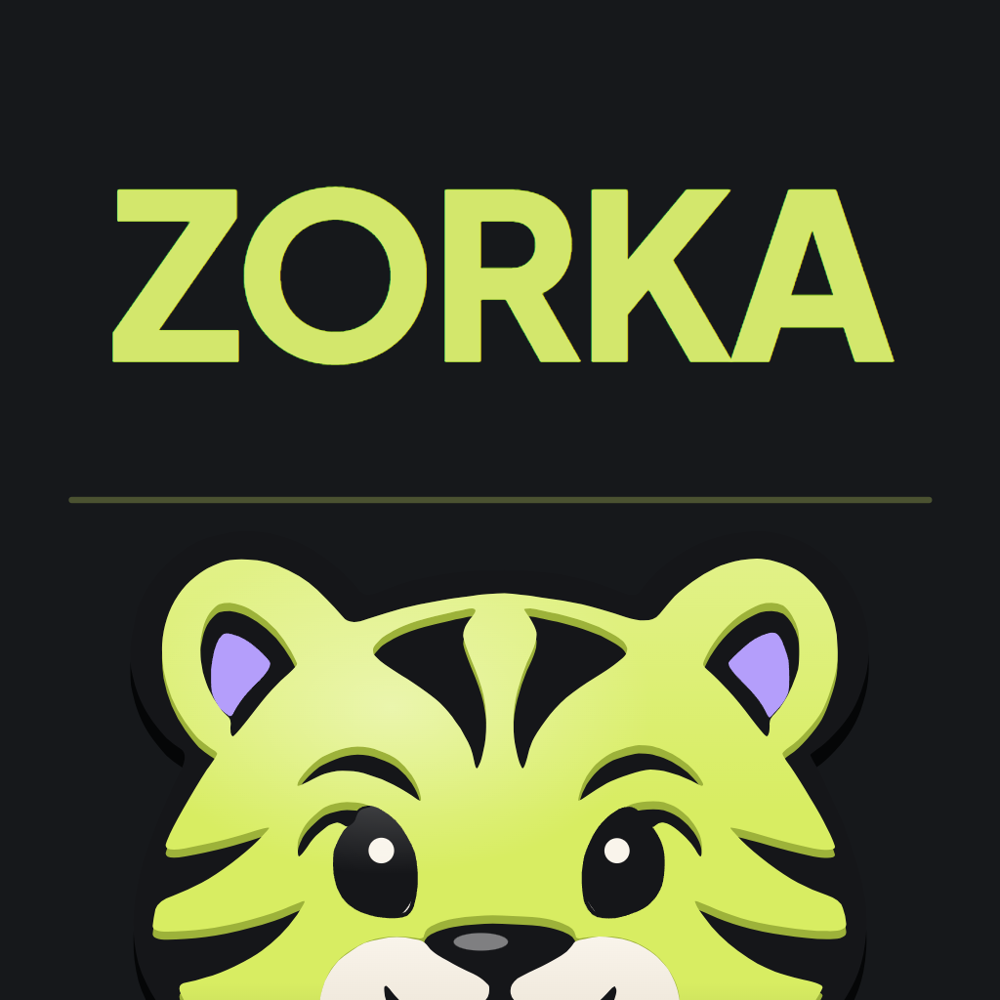
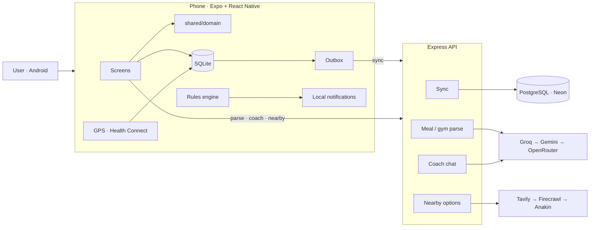

<p align="center">
  
</p>

<h1 align="center">Zorka</h1>

<p align="center">
  Your calories, workouts and cardio in one app, and it tells you what to do next.
</p>

As a fitness geek myself, I often had to use three different apps to track my calorie intake, my workouts and my
cardio. So why not have one master app where I can do all of this with the least friction? That's where Zorka comes
into play :)

The goal is to bring in both fitness geeks and everyday people, and let them enjoy that side of the world where
discipline shapes their whole life into something better.

<p align="center">
  
  
  
  
  <br />
  
  
  
  
  
  <br />
  
  
  
  
</p>

---

## What it is

**Log**
- Log meals by voice, photo or text, and always review them before saving
- Repeat a past meal in one tap
- Log gym sets by voice, with last session's numbers, a rest timer and PR detection
- Record runs, walks and rides with GPS, offline and with the screen off

**Close the gap**
- See the calories and protein left today, paced to the time of day
- Get 3–5 ranked ways to close the gap: your usual meals, home foods or nearby options
- A coach persona who nudges you during the day and chats when you need it

**See your progress**
- 90-second onboarding with a real goal and target date
- A smoothed weight trend that ignores water swings
- A weekly check-in that adjusts your targets from what actually happened
- Phases with a frozen summary when they end
- A streak with freezes, celebrations and share cards

## How it works

- **Local-first.** Every log is saved on the phone first and synced to the server later, so nothing waits on the network.
- **One shared brain.** Targets, the gap, the trend, the streak and the nudge rules live in one pure TypeScript
  layer, used by both the phone and the server.
- **AI drafts, you decide.** Voice, photos and text become food items through an AI chain with fallbacks. You
  always confirm before anything is saved.
- **Safe by design.** Calorie floors, capped weekly changes, no late-night workouts and no shaming copy.

## Architecture



```
backend/   Express + Prisma API
mobile/    Expo app
shared/    Pure domain logic used by both
```

The full diagram is in `docs-arch/architecture.excalidraw` (open it at [excalidraw.com](https://excalidraw.com)).

## Trade-offs

| Chose | Over | Because |
|---|---|---|
| Local-first + sync | Server-only CRUD | Logging has to work in a basement gym |
| Last-write-wins sync | Merge-level conflict resolution | One user on one phone, so conflicts are rare |
| Streak and targets derived from logs | Stored values | Nothing to drift out of sync |
| Local notifications | Push from a server | No Firebase, and it works offline |
| Free-tier AI with fallbacks | One paid model | Zero cost; the confirm step absorbs model variance |
| Search snippets for nearby food | Live menus | No scraping; every number is marked as an estimate |

## Future plans

- Real accounts and auth
- Community features: follows, kudos and leagues
- Hinglish voice logging
- iOS support with HealthKit
- Nudges that adapt to the ones you ignore
- Calorie credit for gym sessions

## Run it locally

```bash
# API
cd backend && npm install
cp .env.example .env    # fill in DATABASE_URL, DIRECT_URL and any AI/search keys
npm run db:migrate && npm run db:seed && npm run dev

# App
cd mobile && npm install
echo "EXPO_PUBLIC_API_URL=http://<your-LAN-IP>:4000" > .env
npx expo run:android
```
