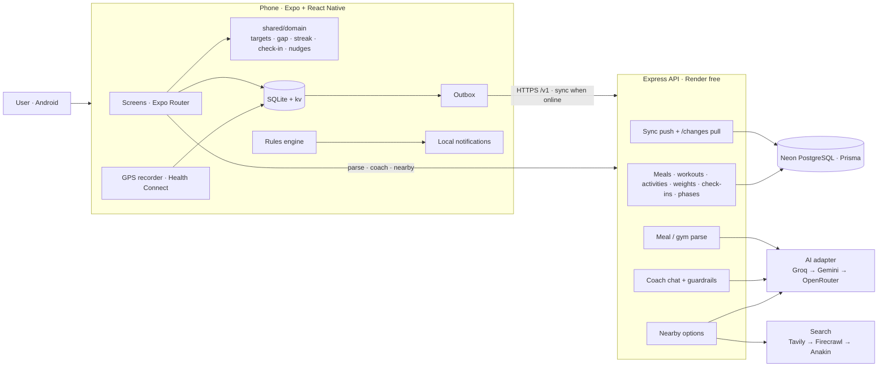

# Zorka

The app is branded Zorka; existing Android/Expo identifiers, deep links,
local storage names and seeded data IDs retain their original names so installed apps keep their data.
Rebuild the APK to update the launcher name and native permission descriptions.

A personal health assistant for Android that turns logging into guidance. You speak or snap a meal, record a
run with the screen off, log a set between sets. Then the app tells you what's left for today and the easiest way
to close it, and adjusts your targets every week from what actually happened.

It's built for someone who today juggles three apps (a gym log, a calorie counter and a run tracker) and still
doesn't know what to do at 8:30 PM. Zorka replaces those three with one app and adds the missing piece: a next step.

> Android APK · Expo + React Native · Node/Express · PostgreSQL (Neon) · free-tier AI only

---

## What it is

Three hero flows, built deep rather than wide. Everything else in the app exists to serve one of them.

| Flow | The user's job | What Zorka does |
|---|---|---|
| **A · Log & record** | "Logging takes too long." | Voice, photo or text becomes foods and portions on a confirm sheet (~3 s). "Repeat yesterday's breakfast" logs in one tap. Gym sets by voice ("bench 80 kilos, 8 reps") with last session's numbers, rest timer and PR detection. GPS run/walk/ride recording that works offline, in the background, with the screen locked. |
| **B · Close the gap** | "It's 8:30 PM. Now what?" | A gap card shows calories and protein left, paced to the time of day. It ranks 3–5 ways to close it: your usual meals, home foods, nearby Zomato/Blinkit options; or, when over, a walk (never a run at 11 PM: tomorrow's target eases instead). A coach persona says it in their own voice, in the app and in nudges. |
| **C · See your progress** | "Is any of this working?" | A 90-second onboarding with a real goal and date. A smoothed weight trend that ignores water swings. A Sunday check-in that moves targets by at most ±150 kcal using your real burn. Phases run like projects, with a frozen summary. A Duolingo-style streak with freezes. Share cards. |

**Today** is the single home screen: calories/protein/activity, the next-best action, the coach's line, the
streak, and a quick-log button (mic, camera, type, search, workout, run, weight). There is no profile screen:
your progress *is* the home screen.

## The three hero flows

**A day with Zorka (the demo path)**

1. **08:00.** A notification: *"Today's plan: 2,100 kcal and 130 g protein."*
2. **13:30.** Hold the mic: *"2 roti, 1 katori rajma, some salad, a glass of chaas."* The confirm sheet shows four
   items; "salad" is flagged as uncertain. One tap saves it.
3. **18:30.** At the gym: *"bench 80 kilos, 8 reps."* The set lands next to last week's 77.5 × 8, the rest timer
   starts, and set 3 earns a PR badge with a success haptic. Finishing opens a PR celebration and a share card.
4. **20:30.** Home: *"45 g protein left · 4 ways to close it"*. Paneer tikka (your usual), a grilled-chicken bowl
   nearby, Greek yogurt on Blinkit, eggs at home.
5. **23:00, 400 kcal over.** No run is suggested. *"Rest tonight; tomorrow's target eases by 150."*
6. **Sunday.** *"Your trend is down 0.4 kg. The scale says +0.3: water, not fat. Your target moves to 1,950."*
7. **Five days away.** *"Welcome back. Your trend held steady."* A freeze protected the streak.

## Why these choices

- **The confirm sheet is always shown.** Image models still misjudge Indian mixed dishes and portions, and oil/ghee
  can swing home-food calories by 20–30%. AI drafts; the user decides. An optional oil/ghee question exists for
  home-cooked items.
- **Guidance over storage.** Every log feeds the gap, the streak and the weekly check-in, so logging always pays
  off. The assistant is proactive: a rules engine decides *when* to speak (at most 4 a day, quiet hours, a priority
  order), and the persona decides *how*.
- **Safe by construction.** Targets never go below a calorie floor, weekly changes are capped, no activity after
  21:30 and none over 60 minutes, and no shaming copy. The coach chat has code guardrails on top of its prompt:
  a word filter, plus a fixed supportive reply for disordered-eating signals that never calls the AI.
- **Local-first.** Gyms have no signal and runs go through dead zones. Every log writes to SQLite first and syncs
  later, so nothing waits on the network.
- **Free tier everywhere.** AI goes through a fallback chain across providers and keys; search and hosting are free
  tiers. The trade-offs are listed below.
- **Dark by default, with a reason.** The key moments are early-morning and evening gym sessions, logging between
  sets, evening runs and the 8:30 PM decision. Dark cuts glare in dim gyms and at night. Pastel-neon numbers on
  obsidian read in a two-second glance mid-set. Dark pixels save OLED battery during long GPS recordings. A full
  light theme ships too: dark is the default, not forced.

## How it works

**Local-first sync.** Meals, workouts, GPS activities, weigh-ins, check-ins and phases are written to on-device
SQLite and to an outbox row in one transaction. The outbox flushes FIFO in batches of 50 to
`POST /v1/users/:id/sync`. It flushes on start, after each write, on reconnect and on foreground, with backoff.
The server resolves last-write-wins on `clientUpdatedAt` and returns applied / stale / rejected per op. A pull feed
(`/changes`) restores everything on a new phone or a reinstall. Local rows with unsynced changes are never
overwritten.

**One domain, two runtimes.** The formulas live in `shared/domain/*.ts`, pure TypeScript with no imports and no
I/O, used by the phone *and* the server: targets (Mifflin-St Jeor × activity, goal pace, floor), the gap,
the EMA weight trend, the weekly check-in, the streak, move options and the nudge rules. The phone therefore shows
the same numbers offline that the server would compute. Most of the 255+ backend tests cover this layer.

**Derived, not stored.** The streak, the gap and the day's targets are recomputed from the logs every time, so
there is nothing to drift out of sync. A log added later for an earlier day just counts.

**AI with a fallback chain.** One parsing pipeline serves voice, photo and text. Speech-to-text (Whisper) or a vision
model turns the input into text, an LLM extracts structured items, Zod validates them, and the items are matched
against a curated Indian-food database with unit portions (katori, roti, plate). Providers are tried in order
(Groq → Gemini → OpenRouter), across several keys each. A rate-limited, failed or off-schema reply cools that slot
down and moves on. If all fail, the phone falls back to manual search; nothing blocks logging.

**Nearby options without scraping.** Zomato and Blinkit have no public ordering API. Zorka takes search-engine
results (title, snippet, URL) from Tavily → Firecrawl → Anakin, has the AI estimate macros from the snippet (each
labelled ≈), and caches results for 12 h per area. It never fetches their pages. Location leaves the phone only
as a locality or pincode.

**Notifications without a push server.** The rules engine runs on the phone and re-plans today's local
notifications whenever the app opens or something is logged. It needs no Firebase and no tokens, and it works
offline.

**Background GPS.** A foreground service records route points to SQLite with timestamps, survives the screen
turning off, and handles pauses and GPS gaps (drawn as breaks, never as straight lines). It produces splits and a
MET-based calorie credit that raises the day's budget once per session.

## Architecture

The full diagram is `docs-arch/architecture.excalidraw`: open it at [excalidraw.com](https://excalidraw.com)
(File → Open). The same picture as Mermaid, which renders on GitHub:



**Repo layout**

```
backend/   Express 5 + Prisma 7 API. src/modules/<feature>/{routes,service,repository,schemas}; Zod at every edge
mobile/    Expo SDK 57 app. src/app = routes (Expo Router), src/features/<feature>, src/core = theme, ui, api, storage, sync
shared/    Pure domain logic used by both (no dependencies)
render.yaml  Deployment blueprint for the API
```

The backend is layered per feature: routes validate with Zod, services hold the rules, and repositories hide
Prisma behind interfaces. Tests run services against in-memory fakes, and supertest covers the HTTP edge.
Dependencies are wired in one place (`src/index.ts`), so swapping a repository or the AI client means changing one
line.

## Tech stack

| Layer | Choice | Why |
|---|---|---|
| Mobile | Expo SDK 57 (custom dev build), React Native 0.86, TypeScript, Expo Router | Background GPS and Health Connect need native modules; the router gives typed file-based routes |
| State / data | expo-sqlite (local-first), Zustand, TanStack Query | Synchronous local reads, a small store, server cache for profile/catalogs |
| Motion / share | Reanimated (confetti, no Lottie), react-native-view-shot + expo-sharing, expo-haptics | Celebrations without a new animation library; cards captured from real views |
| Maps | MapLibre + OpenFreeMap tiles (free, no key), SVG route fallback offline | No API key and no billing |
| Backend | Node 22, Express 5, Prisma 7 (pg adapter), Zod, pino | Typed end to end; validated env; structured logs |
| Database | PostgreSQL on Neon (pooled for the app, direct for migrations) | Free tier with branching for safe migrations |
| AI | Groq / Gemini / OpenRouter free tiers via plain `fetch` | No SDK lock-in; the fallback chain survives rate limits |
| Hosting | Render free web service (API), EAS Build (APK) | HTTPS out of the box; reproducible APKs |

## Setup

Requirements: Node 22+, npm, an Android phone or emulator, a Neon project.

### Backend

```bash
cd backend
npm install                 # also runs prisma generate
cp .env.example .env        # then fill in DATABASE_URL, DIRECT_URL and any AI/search keys
npm run db:migrate          # apply migrations (use a Neon branch first)
npm run db:seed             # 3 demo users, ~200 foods, 111 exercises (idempotent)
npm run db:seed:arjun       # 8-week history for Arjun (fitness geek)
npm run db:seed:demo        # 8-week histories for Riya (casual) and Meera (returning after 5 days)
npm run dev                 # http://localhost:4000/v1/health
npm test                    # Vitest
```

Every seed is idempotent: stable ids plus insert-only, so re-running changes nothing. `:dry` variants
(`db:seed:demo:dry`, `db:seed:arjun:dry`) print what they would write.

### Mobile (Android)

```bash
cd mobile
npm install
echo "EXPO_PUBLIC_API_URL=http://<your-LAN-IP>:4000" > .env
npx expo run:android        # builds and installs the dev client (needed for GPS, Health Connect, notifications)
npm run typecheck && npm run lint
npm run bundle:check        # Hermes bundle size against the budget
```

**Production APK:** `eas build -p android --profile preview`. The `preview` profile bakes in the hosted API URL
(`eas.json`).

### Environment variables

`backend/.env` (never committed; see `backend/.env.example`):

| Variable | Purpose |
|---|---|
| `DATABASE_URL` | Neon **pooled** connection string (runtime) |
| `DIRECT_URL` | Neon **direct** connection string (migrations) |
| `PORT`, `LOG_LEVEL`, `NODE_ENV` | Server basics |
| `GROQ_API_KEYS`, `GEMINI_API_KEYS`, `OPENROUTER_API_KEYS` | Comma-separated keys; any may be empty (AI features then fall back to search) |
| `AI_PROVIDER_ORDER` | Default `groq,gemini,openrouter` |
| `TAVILY_API_KEY`, `FIRECRAWL_API_KEY`, `ANAKIN_API_KEY`, `SEARCH_PROVIDER_ORDER` | Nearby options (optional) |

`mobile/.env`: `EXPO_PUBLIC_API_URL` (the API origin, without `/v1`).

### Deploying the API

`render.yaml` is a Render Blueprint. In Render choose New → Blueprint, pick the repo, then paste the secret values in
the dashboard. Free instances sleep after 15 minutes; the app sends a wake-up request at launch, so the first screen
doesn't hit a cold-start timeout.

## Design system

Plus Jakarta Sans only, Material Symbols Rounded, and a token-only theme (no hex values in components). The
palette is lime / lilac / orchid on obsidian, with locked data colours: kcal and carbs lime, protein orchid, fat
and activity lilac. Number + unit is the brand signature. At most one glow per screen. Touch targets are ≥ 48 dp,
text survives 130% font scaling, and reduced motion turns off confetti and count-ups. There are no food photos
(category icon tiles instead) and no stock avatars.

## Trade-offs

| Decision | Gave up | Because |
|---|---|---|
| Local-first SQLite + outbox | Simpler server-only CRUD | Logging must work in a basement gym; sync is invisible when it works |
| Last-write-wins sync | Merge-level conflict resolution | One user per profile on one phone; conflicts are rare and LWW is predictable |
| Streak, gap and targets derived from logs | A stored, queryable streak | No drift and no backfills; recomputing is cheap on-device |
| Weekly check-in computed lazily on the phone | A server cron | Works offline, needs no scheduler on a sleeping free host |
| Local notifications re-planned on device | Real push from a server | No Firebase, no tokens, works offline; messages use the last plan if the app isn't opened |
| Free-tier AI across providers and keys | Consistency of a single paid model | Zero cost; the confirm sheet absorbs model variance |
| Search snippets for Zomato/Blinkit | Live menus and exact macros | Respects their terms (no scraping); every number is labelled an estimate |
| Render free tier | Always-on latency | ~30–50 s cold start after idle; a launch wake-up ping hides most of it |
| 3 demo profiles, no auth | Real accounts | The assignment allows it; profiles switch from Settings |
| GPS activities and chat history on the phone | Cross-device history for those | Keeps raw location off the server; activities do sync their summaries |

## Left out of v1 (and why)

- **Community and social feed** (follows, kudos, leagues). v1 is about personal progress; share cards cover
  outward sharing.
- **Hinglish voice.** English first; Whisper was chosen so Hinglish isn't ruled out later.
- **Lab report upload and biomarkers.** Not a daily, visible, actionable outcome, so it would dilute the three
  flows.
- **Real auth.** Three demo profiles simulate real usage without an account system.
- **iOS polish.** Android first (the APK is the deliverable); the code is cross-platform, but HealthKit and the
  iOS background modes aren't wired.
- **Learning from dismissed notifications.** The daily cap and quiet hours exist; adapting to ignored nudges does not
  yet.
- **Gym calories in the budget.** Only GPS activities add burned calories; lifting estimates are too noisy to
  credit honestly.

## Self-evaluation

Checked against the assignment's criteria and its self-evaluation questions.

| Question | Answer | Where |
|---|---|---|
| Am I onboarded clearly with a meaningful goal? | Yes. Six short steps produce a goal, pace, target weight and date, explained targets (S09), and a coach pick. About 90 seconds. | Onboarding S02–S09 |
| Does the app explain what to improve and why? | Yes. The gap card names the one gap that matters now ("45 g protein left") and ranks ways to close it. The Sunday check-in explains the target change with the burn estimate and the water-weight caveat. | S10, S41, S35 |
| Is the assistant proactive rather than passive? | Yes. A rules engine plans up to 4 nudges a day (morning plan, protein warning, workout reminder, slipping, streak at risk, praise) and taps open the screen that fixes it. Chat is there, but you don't need it. | Nudges, S45 |
| Does the UX motivate with positive reinforcement? | Yes. Streak with freezes (no guilt resets), celebrations for 7/30/100 days, PRs, all-goals days and finished phases, share cards, "Welcome back" instead of shame. | S40, S47, S46, S48 |
| Is it intuitive? | Mostly. One home screen and one + button for every log type. The weak spot is first-run AI without keys: features degrade to search with a clear message. | S10, S11 |
| Would I open it daily for 90 days? | The streak, the 8:30 PM gap card and the weekly target change give daily and weekly reasons. Phases give a longer arc. | Flow C |
| Real health value, not static logging? | Targets adapt to measured burn, the gap turns data into tonight's action, and safety rails (floor, caps, no late runs) keep it healthy. | shared/domain |

**Engineering checks**

- **Functional features:** all three flows are implemented end to end and run on the seeded demo profiles.
  Typecheck, lint and the backend test suite pass; on-device checks are listed per phase.
- **Architecture:** feature modules, a pure shared domain, repositories behind interfaces, Zod at every boundary,
  validated env, one composition root.
- **Edge cases:** offline (banner, sync pill, queued voice notes, offline GPS), permission denied (explainer + "Open
  settings" for mic, camera, location, Health Connect, notifications), empty and loading states, AI or search down,
  5 days away, over target at 11 PM.
- **Bundle size:** Hermes bundle budget of 5 MB checked by `npm run bundle:check`; unused dependencies removed.
- **Commits:** one commit per phase (`phase-NN: …`), so any phase can be reverted on its own; every migration ships
  a reviewed down script.

**Honest gaps:** no real-device acceptance run has been recorded here for the 5 km locked-screen GPS test.
Nearby-option quality depends on search snippets. The logo is still a placeholder mark.
